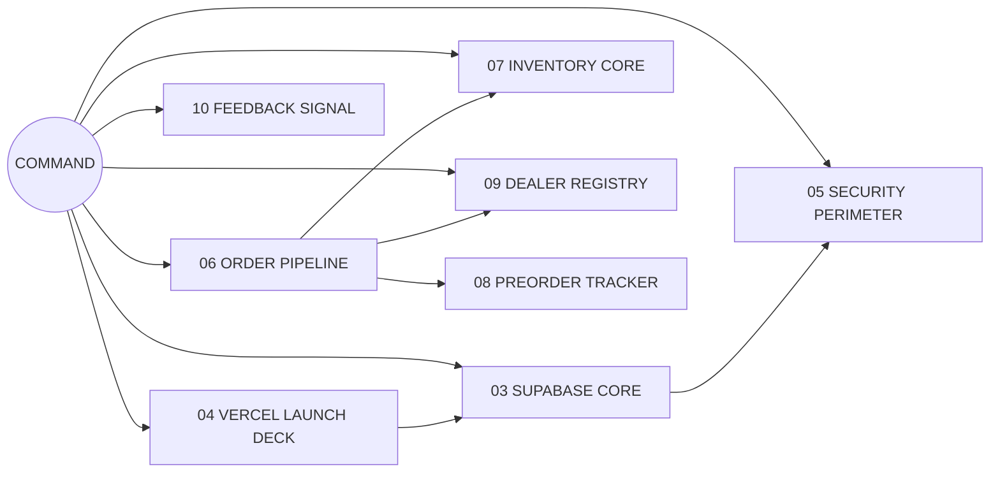

# ◈ HAPPY TIME — COMMAND CENTER

> [!quote] INITIALISING
> *"Good to see you again."* — system greeting, [[11 DEALER PLAYBOOK]]

> [!info] SYSTEM STATUS · `LOG 2026-11-04`
> | SUBSYSTEM | STATE | LINK |
> |---|---|---|
> | CORE DATABASE | 🟢 HEALTHY | [[03 SUPABASE CORE]] |
> | DEPLOYMENT EDGE | 🟢 READY | [[04 VERCEL LAUNCH DECK]] |
> | SECURITY SHIELD | 🔴 **OPEN** | [[05 SECURITY PERIMETER]] |
> | ORDER PIPELINE | 🟡 8 ORDERS | [[06 ORDER PIPELINE]] |
> | INVENTORY CORE | 🟠 3 FAULTS | [[07 INVENTORY CORE]] |
> | DEALER NETWORK | 🟢 7 NODES | [[09 DEALER REGISTRY]] |
> | SIGNAL INBOX | 🟢 4 MESSAGES | [[10 FEEDBACK SIGNAL]] |

---

## ◈ SUBSYSTEM MAP

---

## ◈ OPERATIONS

- [[06 ORDER PIPELINE]] — every order, every state
- [[07 INVENTORY CORE]] — stock, reserve, release
- [[08 PREORDER TRACKER]] — promises not yet hardware
- [[09 DEALER REGISTRY]] — the wholesale network
- [[10 FEEDBACK SIGNAL]] — what the street is saying
- [[11 DEALER PLAYBOOK]] — dealer-side briefing
- [[12 STAFF RUNBOOK]] — shift procedures

## ◈ INFRASTRUCTURE

- [[03 SUPABASE CORE]] — Postgres 17 · `ap-southeast-1`
- [[04 VERCEL LAUNCH DECK]] — `happy-time-connect.vercel.app`
- [[05 SECURITY PERIMETER]] — the perimeter is DOWN
- [[13 NIGHTLY DIAGNOSTICS]] — automated health checks
- [[20 PERFORMANCE CORE]] — why the app feels slow (measured)
- [[02 SYSTEM MAP]] — full architecture

## ◈ INTELLIGENCE

- [[14 INCIDENT LOG]] — what broke, when, why
- [[15 METRICS BOARD]] — numbers that matter
- [[16 ROADMAP PHASES]] — the six phases
- [[17 GLOSSARY]] — decode the language
- [[18 AGENTS AND ROLES]] — who commands what
- [[19 WHOLESALE DOCTRINE]] — operating principles
- [[01 JARVIS PROTOCOL]] — behaviour of the assistant

---

> [!warning] PRIORITY DIRECTIVE
> **THE PERIMETER IS OPEN.** Any visitor can read, modify, or erase the core. Until [[05 SECURITY PERIMETER]] reports `CLOSED`, this system is not cleared for live dealer traffic. Full fault list: [[APP-ISSUES]].

> [!tip] DOCUMENT ROOT
> This HUD overlays the project documents: [[PROJECT-NOTES]] (technical), [[PROJECT-NOTES-SIMPLE]] (plain language), [[SUMMARY]] (business brief), [[APP-ISSUES]] (defect log).

## Graph
- [[Network Cluster]]
- [[Intel Cluster]]
- [[Operations Cluster]]
