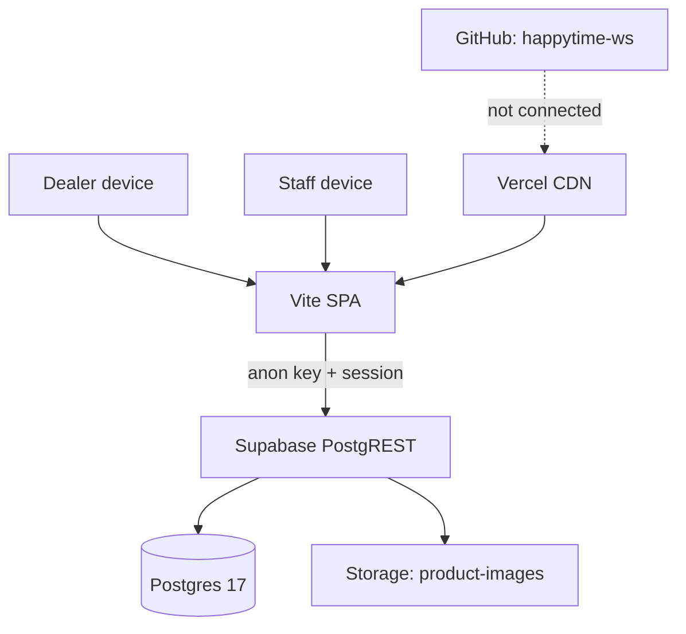

# ◈ SYSTEM MAP

> How [[00 COMMAND CENTER]] is physically built. There is **no application server** — the browser speaks directly to the database.

## TOPOLOGY



## LAYERS

| Layer | Technology | Notes |
|---|---|---|
| Front end | Vite single-page app | Ships to `dist/`, talks REST directly |
| Data | [[03 SUPABASE CORE]] | Postgres 17, region `ap-southeast-1` |
| Files | Storage bucket `product-images` | Public read, **no write policy** |
| Hosting | [[04 VERCEL LAUNCH DECK]] | Static + rewrites, region `iad1` |
| Trust boundary | [[05 SECURITY PERIMETER]] | RLS is the only wall |

## BUILD CONTRACT

```
install : npm install
build   : npm run build
output  : dist
node    : 26.x
env     : VITE_SUPABASE_URL, VITE_SUPABASE_ANON_KEY
```

## CONSEQUENCES OF A SERVERLESS FRONT END

1. Every secret in the bundle is public. The `service_role` key must never enter the SPA.
2. The database must defend itself — RLS is not optional, it *is* the backend.
3. Business rules live in Postgres (constraints, triggers, functions), not in the client.

## KNOWN FRACTURES

- Vercel is **not** connected to Git — the live site cannot be traced to a commit. → [[04 VERCEL LAUNCH DECK]]
- The app source is not in the repository — only notes are. → [[14 INCIDENT LOG]]
- Every policy is `USING true` → [[05 SECURITY PERIMETER]]

## LINKED SYSTEMS

[[00 COMMAND CENTER]] · [[03 SUPABASE CORE]] · [[04 VERCEL LAUNCH DECK]] · [[05 SECURITY PERIMETER]] · [[13 NIGHTLY DIAGNOSTICS]] · [[PROJECT-NOTES]]

## Graph
- [[Network Cluster]]
- [[Intel Cluster]]
- [[Operations Cluster]]
