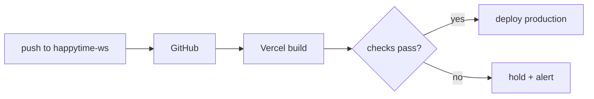

# ◈ VERCEL LAUNCH DECK

> Launch control for `happy-time-connect.vercel.app`. Project `happy-time-connect`, team `shan-8dde`, Hobby plan.

## FLIGHT RECORD

| FIELD | VALUE |
|---|---|
| Live URL | `https://happy-time-connect.vercel.app` |
| Frame | Vite → `dist/` |
| Node | 26.x |
| Region | `iad1` |
| Deployments | 2 — both `production` |
| First launch | 2026-11-03 12:19 UTC |
| Current flight | 2026-11-04 04:35 UTC |
| Custom domain | **NONE** |
| Git link | **NONE** ⚠ |

## LAUNCH SEQUENCE (CURRENT)

```bash
vercel --prod
```

Manual, from a laptop. No traceability between the live build and a commit.

## LAUNCH SEQUENCE (TARGET)



## ENVIRONMENT PAYLOAD

`VITE_SUPABASE_URL` · `VITE_SUPABASE_ANON_KEY` — set for production, preview, development. The anon key is public by design; the core is only safe if [[05 SECURITY PERIMETER]] holds.

## RISK BOARD

| RISK | STATE |
|---|---|
| No Git link — cannot roll back to a known commit | 🔴 OPEN |
| No staging — tests run on live data | 🟠 OPEN |
| No custom domain on dealer paperwork | 🟡 OPEN |
| Previews protected by Vercel SSO | 🟢 GOOD |
| Source maps protected | 🟢 GOOD |

## LINKED SYSTEMS

[[00 COMMAND CENTER]] · [[02 SYSTEM MAP]] · [[03 SUPABASE CORE]] · [[05 SECURITY PERIMETER]] · [[13 NIGHTLY DIAGNOSTICS]] · [[16 ROADMAP PHASES]]

## Graph
- [[Network Cluster]]
- [[Intel Cluster]]
- [[Operations Cluster]]
