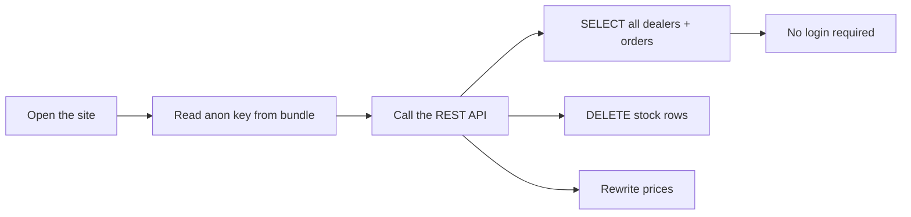

# ◈ SECURITY PERIMETER

> [!danger] PERIMETER BREACHED
> **Every public table accepts anonymous read, insert, update and delete.**
> The anon key ships inside the browser bundle. Anyone who opens the site can wipe the core.

## THREAT BOARD

| ID | THREAT | STATE | IMPACT |
|---|---|---|---|
| SEC-01 | RLS `USING true` on all 7 tables | 🔴 LIVE | total data loss possible |
| SEC-02 | `auth.users = 0` — no real identities | 🔴 LIVE | no one can be trusted or scoped |
| SEC-03 | Demo admin button on public login | 🔴 LIVE | console open to strangers |
| SEC-04 | `profiles` readable anonymously | 🟠 LIVE | leak once populated |
| SEC-05 | Password floor 6, no breach check, no MFA | 🟠 LIVE | account takeover |
| SEC-06 | Feedback form unthrottled | 🟡 LIVE | signal inbox spam |

## WHAT AN ATTACKER CAN DO RIGHT NOW

## THE SHIELD TO BUILD

1. A policy per table keyed to `auth.uid()`.
2. Dealers see their own rows only; staff hold a role claim.
3. Server-side functions for anything that moves stock or money.
4. Demo buttons behind a dev-only flag.
5. MFA for staff accounts.

## STANDING ORDERS

- No live dealer traffic until SEC-01 and SEC-02 read `CLOSED`.
- Log every exposure in [[14 INCIDENT LOG]].
- Re-check after each deployment: [[13 NIGHTLY DIAGNOSTICS]].

Fault detail: [[APP-ISSUES]] items 1–6. Data model behind it: [[03 SUPABASE CORE]].

## LINKED SYSTEMS

[[00 COMMAND CENTER]] · [[02 SYSTEM MAP]] · [[03 SUPABASE CORE]] · [[04 VERCEL LAUNCH DECK]] · [[12 STAFF RUNBOOK]] · [[14 INCIDENT LOG]] · [[16 ROADMAP PHASES]]

## Graph
- [[Network Cluster]]
- [[Intel Cluster]]
- [[Operations Cluster]]
