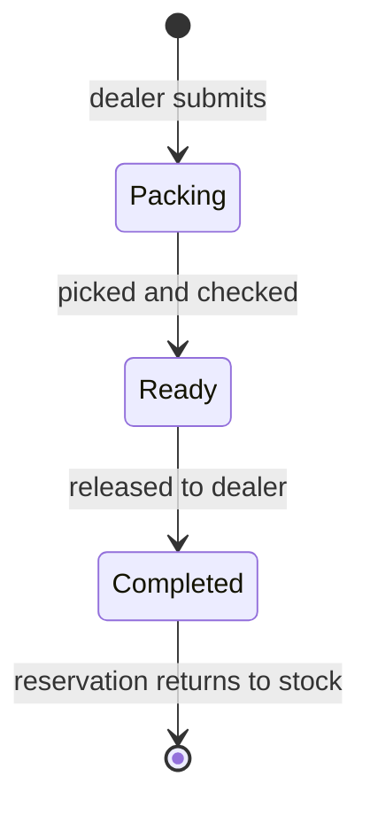

# ◈ ORDER PIPELINE

> Ledger of wholesale movement. Source table `ht_orders` in [[03 SUPABASE CORE]].

## CURRENT LOAD

| METRIC | READING |
|---|---|
| Orders | 8 |
| Completed | 6 |
| Ready | 1 |
| Packing | 1 |
| Channels | Wholesale 6 · Counter 1 · Pre-order 1 |
| Total settlement | unreconciled ⚠ |

## STATE MACHINE

> [!bug] FAULT — RELEASE NEVER HAPPENS
> `Completed` does not return reserved units to availability. That is the root cause of the negative stock in [[07 INVENTORY CORE]].

## RECONCILIATION FAILURES

| ORDER | LINES SUM | STORED AMOUNT | GAP |
|---|---|---|---|
| `WC-1008` | 39,620 | 39,636 | +16 |
| `WC-1009` | 282,760 | 330,083 | +47,323 |

All **8 of 8** orders disagree with their own lines. No tax, discount or shipping fields exist, so the difference cannot be explained → invoices are not trustworthy.

## ORPHAN WATCH

One order points to a dealer that is not in [[09 DEALER REGISTRY]] — `Nuwara Eliya Clock House`. With no foreign keys, nothing prevents this.

## FIX SEQUENCE

1. Line-level `total` on every item.
2. Explicit tax / discount / delivery fields.
3. `amount` computed by the database, never typed.
4. Release reservation on `Completed`.
5. Foreign key to the dealer registry.

Tracking: [[APP-ISSUES]] items 11–13, 18–21 · Plan: [[16 ROADMAP PHASES]]

## LINKED SYSTEMS

[[00 COMMAND CENTER]] · [[03 SUPABASE CORE]] · [[07 INVENTORY CORE]] · [[08 PREORDER TRACKER]] · [[09 DEALER REGISTRY]] · [[12 STAFF RUNBOOK]] · [[17 GLOSSARY]]

## Graph
- [[Network Cluster]]
- [[Intel Cluster]]
- [[Operations Cluster]]
