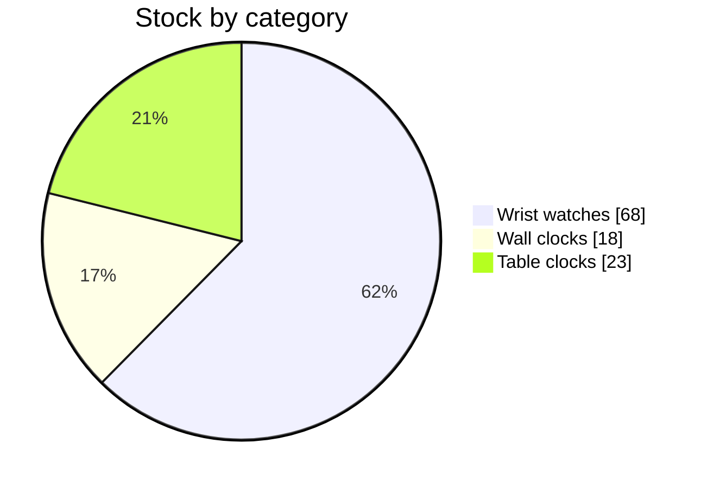

# ◈ INVENTORY CORE

> Physical hardware and what is already promised. Source table `ht_products`.

## THE EQUATION

```
AVAILABLE  =  STOCK  −  RESERVED
```

> [!failure] THREE LINES READ NEGATIVE
> | SKU | MODEL | STOCK | RESERVED | AVAILABLE |
> |---|---|---|---|---|
> | HT-W-214 | Meridian Automatic 40mm | 4 | 22 | **−18** |
> | HT-W-330 | Diver Chronograph 42mm | 2 | 7 | **−5** |
> | HT-W-512 | Skeleton Tourbillon — Dealer Ed. | 1 | 15 | **−14** |

## LOAD SHEET

| SKU | MODEL | CATEGORY | STOCK | RESERVED | PRICE (LKR) |
|---|---|---|---|---|---|
| HT-W-118 | Aurelia Slim Quartz | Wrist | 61 | 14 | 4,190 |
| HT-C-017 | Pendulum Table Clock | Table | 23 | 3 | 4,520 |
| HT-C-042 | Regulator Wall Clock 30cm | Wall | 18 | 5 | 5,212 |
| HT-W-214 | Meridian Automatic 40mm | Wrist | 4 | 22 | 12,450 |
| HT-W-330 | Diver Chronograph 42mm | Wrist | 2 | 7 | 15,985 |
| HT-W-512 | Skeleton Tourbillon — Dealer Ed. | Wrist | 1 | 15 | 69,377 |

## DISTRIBUTION



## RECOVERY STEPS

1. Freeze new reservations on the three negative SKUs.
2. Recompute `reserved` from orders that are genuinely open — [[06 ORDER PIPELINE]].
3. Release on completion (code change).
4. Add `CHECK (reserved >= 0 AND reserved <= stock)`.
5. Delete `reservedQty` from order lines — one source of truth only.
6. Replace placeholder images with real photography → [[APP-ISSUES]] item 23.

## LINKED SYSTEMS

[[00 COMMAND CENTER]] · [[03 SUPABASE CORE]] · [[06 ORDER PIPELINE]] · [[08 PREORDER TRACKER]] · [[15 METRICS BOARD]] · [[14 INCIDENT LOG]]

## Graph
- [[Network Cluster]]
- [[Intel Cluster]]
- [[Operations Cluster]]
