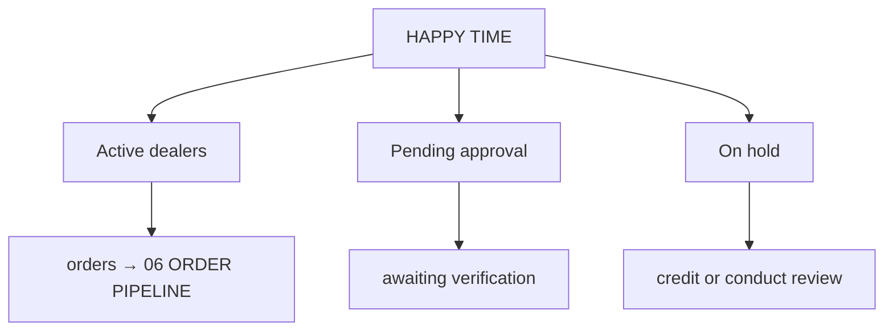

# ◈ DEALER REGISTRY

> The wholesale network. Source table `ht_dealers` — keyed by **name**, not by an id ⚠

## NETWORK LOAD

| STATE | NODES |
|---|---|
| 🟢 Active | 5 |
| 🟡 Pending approval | 1 |
| 🟠 On hold | 1 |
| **Total** | **7** |

## NODE ANATOMY

```
name · email · city · since · status · terms
```

Payment terms and standing live here; orders reference the dealer **by name**, so a rename detaches history.

## NETWORK GRAPH



## STRUCTURAL RISKS

| RISK | CONSEQUENCE |
|---|---|
| Name is the primary key | rename = orphaned orders |
| No link to `auth.users` | a dealer cannot be logged in as themselves |
| No foreign key from orders | ghost dealers exist in the ledger |
| No address column populated | delivery disputes have no reference |

## ONBOARDING SEQUENCE (TARGET)

1. Create the login in Supabase Auth.
2. Create the registry row with the same id.
3. Set status `Pending approval`.
4. Staff verify terms, then flip to `Active`.
5. Dealer receives only their own pipeline → [[11 DEALER PLAYBOOK]].

Faults: [[APP-ISSUES]] items 2, 4, 10–12.

## LINKED SYSTEMS

[[00 COMMAND CENTER]] · [[03 SUPABASE CORE]] · [[06 ORDER PIPELINE]] · [[08 PREORDER TRACKER]] · [[10 FEEDBACK SIGNAL]] · [[11 DEALER PLAYBOOK]] · [[12 STAFF RUNBOOK]]

## Graph
- [[Network Cluster]]
- [[Intel Cluster]]
- [[Operations Cluster]]
