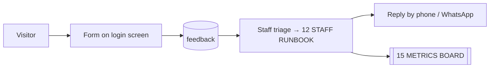

# ◈ FEEDBACK SIGNAL

> Inbound from the street. Source table `feedback` — the only table in the core with real constraints.

## INBOX STATE

| SIGNAL | STATE |
|---|---|
| New | 0 |
| Read | 4 |
| Average rating | 1–5 scale, constrained |
| Channel | Public form on the login page |

## WHY THIS TABLE IS THE MODEL

```sql
CHECK (rating BETWEEN 1 AND 5)
CHECK (status IN ('new','read'))
```

The one place that enforces its own rules → the standard [[03 SUPABASE CORE]] should reach everywhere else.

## SIGNAL FLOW



## RISK

Anonymous inserts allowed with no throttle — the inbox can be flooded → [[05 SECURITY PERIMETER]] SEC-06.

Support channel shown in the app: **077 352 8760** · call, WhatsApp or feedback.

## LINKED SYSTEMS

[[00 COMMAND CENTER]] · [[03 SUPABASE CORE]] · [[05 SECURITY PERIMETER]] · [[09 DEALER REGISTRY]] · [[12 STAFF RUNBOOK]] · [[15 METRICS BOARD]]

## Graph
- [[Network Cluster]]
- [[Intel Cluster]]
- [[Operations Cluster]]
