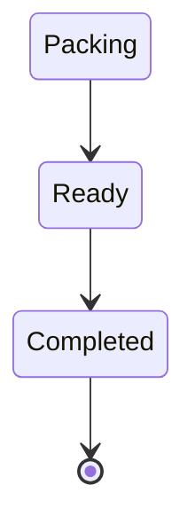

# ◈ DEALER PLAYBOOK

> Briefing for the wholesale customer. Everything here is what the dealer sees behind the login screen.

## FIRST CONTACT

The screen reads *"Good to see you again."* Email and password, a "keep me signed in" switch, and the support line **077 352 8760**.

## WHAT YOU CAN DO

| ACTION | RESULT |
|---|---|
| Browse catalogue | Price and available quantity per model |
| Place an order | Enters [[06 ORDER PIPELINE]] at `Packing` |
| Track an order | `Packing` → `Ready` → `Completed` |
| Raise a pre-order | Enters [[08 PREORDER TRACKER]] |
| Send feedback | Lands in [[10 FEEDBACK SIGNAL]] |

## HOW TO READ AVAILABILITY

```
AVAILABLE  =  STOCK  −  RESERVED
```

> [!caution] NUMBERS MAY READ NEGATIVE
> Three models currently show a negative available figure — a system fault, not your mistake. Confirm by phone before shipping.

## ORDER LIFECYCLE



## HOUSE RULES

1. One login per dealership.
2. Orders are binding once submitted.
3. Pre-orders are promises, not stock.
4. Disputes go to **077 352 8760**, not the feedback box.

## LINKED SYSTEMS

[[00 COMMAND CENTER]] · [[06 ORDER PIPELINE]] · [[07 INVENTORY CORE]] · [[08 PREORDER TRACKER]] · [[09 DEALER REGISTRY]] · [[17 GLOSSARY]] · [[SUMMARY]]

## Graph
- [[Network Cluster]]
- [[Intel Cluster]]
- [[Operations Cluster]]
