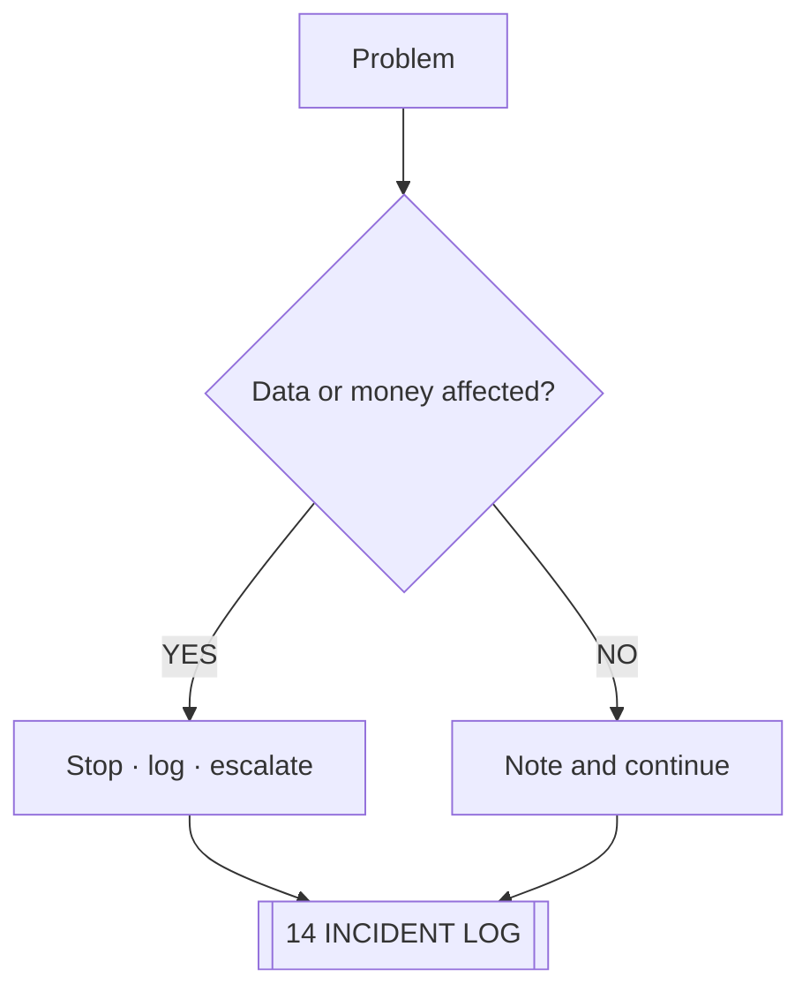

# ◈ STAFF RUNBOOK

> Shift procedure for the online desk. Every task links to the system that owns it.

## OPENING CHECK — 5 MINUTES

- [ ] Core healthy → [[03 SUPABASE CORE]]
- [ ] Site reachable → [[04 VERCEL LAUNCH DECK]]
- [ ] Negative stock lines known → [[07 INVENTORY CORE]]
- [ ] Inbox cleared → [[10 FEEDBACK SIGNAL]]
- [ ] Pending dealers reviewed → [[09 DEALER REGISTRY]]

## DURING SHIFT

| TASK | WHERE | RULE |
|---|---|---|
| New order | [[06 ORDER PIPELINE]] | Confirm unit count against availability |
| Stock check | [[07 INVENTORY CORE]] | Never promise below zero |
| Pre-order chase | [[08 PREORDER TRACKER]] | Update expected date |
| Dealer approval | [[09 DEALER REGISTRY]] | Terms set before activating |
| Feedback | [[10 FEEDBACK SIGNAL]] | Answer within one working day |

## CLOSING CHECK

- [ ] All `Packing` orders that shipped are marked
- [ ] Reservations released for `Completed`
- [ ] Anything strange written into [[14 INCIDENT LOG]]
- [ ] Numbers for the day copied into [[15 METRICS BOARD]]

## WHEN SOMETHING BREAKS

## NEVER

- Never edit a total by hand — [[06 ORDER PIPELINE]].
- Never test on live dealer data.
- Never share the staff login. See [[05 SECURITY PERIMETER]].

## LINKED SYSTEMS

[[00 COMMAND CENTER]] · [[01 JARVIS PROTOCOL]] · [[06 ORDER PIPELINE]] · [[07 INVENTORY CORE]] · [[13 NIGHTLY DIAGNOSTICS]] · [[14 INCIDENT LOG]] · [[18 AGENTS AND ROLES]]

## Graph
- [[Network Cluster]]
- [[Intel Cluster]]
- [[Operations Cluster]]
