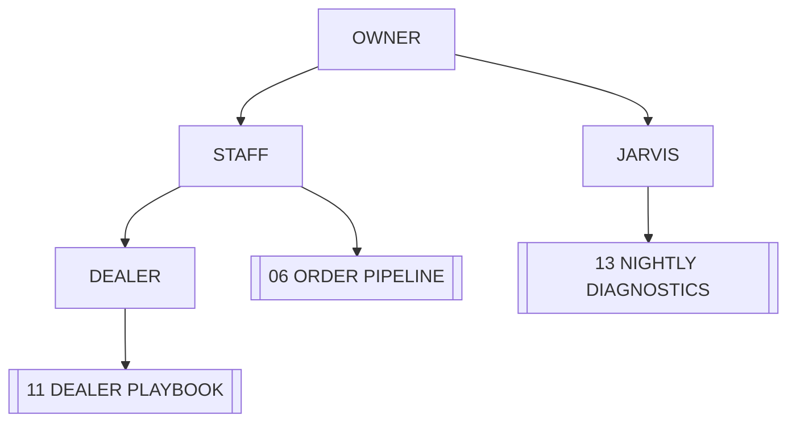

# ◈ AGENTS AND ROLES

> Who may command which system. Every role maps to a permission and a runbook.

## ROLE MATRIX

| ROLE | SEES | ACTS ON | RUNBOOK |
|---|---|---|---|
| **Owner** | everything | price, terms, phase approval | [[16 ROADMAP PHASES]] |
| **Staff / Admin** | all orders, all dealers | orders, stock, dealers, feedback | [[12 STAFF RUNBOOK]] |
| **Dealer** | own orders, catalogue | place orders, raise pre-orders | [[11 DEALER PLAYBOOK]] |
| **Assistant (JARVIS)** | data and configuration | notes, diagnostics, proposals | [[01 JARVIS PROTOCOL]] |
| **Deployment** | build and env only | publish a build | [[04 VERCEL LAUNCH DECK]] |

## ACCESS CHAIN

## CURRENT REALITY

- Registry rows: 7 dealers · 1 staff profile → [[09 DEALER REGISTRY]]
- Real logins in Auth: **0** → [[05 SECURITY PERIMETER]]

> [!warning] Until identity exists, every role is fictional. The matrix above describes the target, not the current build.

## SEPARATION RULES

1. One person, one login.
2. Staff never share credentials.
3. The assistant never acts on the live core without an incident entry in [[14 INCIDENT LOG]].
4. Dealer access is scoped to their own rows, always.

## LINKED SYSTEMS

[[00 COMMAND CENTER]] · [[01 JARVIS PROTOCOL]] · [[05 SECURITY PERIMETER]] · [[09 DEALER REGISTRY]] · [[11 DEALER PLAYBOOK]] · [[12 STAFF RUNBOOK]] · [[19 WHOLESALE DOCTRINE]]

## Graph
- [[Network Cluster]]
- [[Intel Cluster]]
- [[Operations Cluster]]
